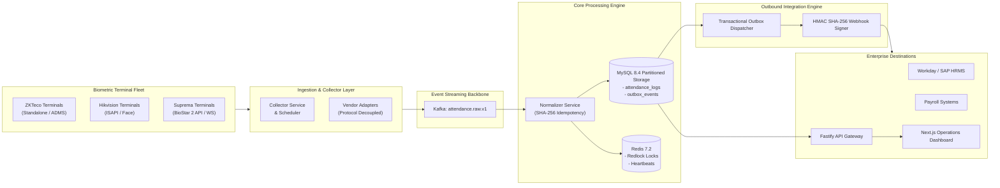

# Enterprise Attendance Integration Platform

Enterprise-grade attendance device integration platform centralizing biometric events from heterogeneous hardware terminals (**ZKTeco**, **Hikvision**, **Suprema**) and delivering canonical, mathematically deduplicated attendance events to downstream HRMS, ERP, payroll, and third-party enterprise applications.

---

## 1. High-Level Architecture & Event Pipeline



---

## 2. Quick Start Guide

### Prerequisites

- **Node.js**: `v22 LTS` (`>= 20.0.0`)
- **pnpm**: `^9.15.0` (`corepack enable` or `npm i -g pnpm`)
- **Docker & Docker Compose**: v2+ (for MySQL 8.4, Redis 7.2, Kafka 3.8, Prometheus, Grafana)

### 1. Install Workspace Dependencies

```powershell
pnpm install
```

### 2. Start Core Infrastructure Containers

Starts MySQL 8.4 (`:3307`), Redis 7.2 (`:6379`), Kafka KRaft (`:9092`), and Kafka UI (`:8080`):

```powershell
pnpm run docker:up
```

### 3. Run Database Migrations & Seeds

```powershell
pnpm run migrate:up
pnpm run seed
```

### 4. Start Development Servers

```powershell
# Start all microservices in parallel
pnpm run dev

# Or start specific applications:
pnpm run dev:api         # API Gateway & Swagger at http://localhost:4000/docs
pnpm run dev:dashboard   # Operations Dashboard at http://localhost:3001
```

### 5. Launch Monitoring Stack (Prometheus & Grafana)

```powershell
docker compose -f docker-compose.monitoring.yml up -d
```

---

## 3. Platform Endpoints & Inspection Tools

| Service                      | Address                                                      | Credentials / Description                                        |
| :--------------------------- | :----------------------------------------------------------- | :--------------------------------------------------------------- |
| **Operations Dashboard**     | **[http://localhost:3001](http://localhost:3001)**           | Next.js 15 App Router & shadcn/ui Control Plane                  |
| **API Gateway & Swagger**    | **[http://localhost:4000/docs](http://localhost:4000/docs)** | OpenAPI Specification & REST Endpoints                           |
| **Grafana SRE Dashboards**   | **[http://localhost:3002](http://localhost:3002)**           | `admin` / `admin_password`                                       |
| **Prometheus Metrics**       | **[http://localhost:9090](http://localhost:9090)**           | Scrape metrics & active SRE alert rules                          |
| **Kafka UI Cluster Manager** | **[http://localhost:8080](http://localhost:8080)**           | Kafka topics, consumer lag, and message inspector                |
| **MySQL 8.4 Database**       | `127.0.0.1:3307`                                             | Database `attendance_db` (`attendance_user` / `attendance_pass`) |
| **Redis 7.2 State Store**    | `127.0.0.1:6379`                                             | Distributed locks & device heartbeats                            |

---

## 4. Key CLI Commands & Verification Scripts

### Device Ingestion & Hardware Test Runners

```powershell
# Hikvision ISAPI live probe and sync runner
pnpm run hikvision:test-conn
pnpm run hikvision:device-info
pnpm run hikvision:sync-once

# Suprema BioStar 2 live probe and realtime listener
pnpm run suprema:test-conn
pnpm run suprema:sync-once
pnpm run suprema:listen-realtime

# ZKTeco standalone probe and sync runner
pnpm run collector:test-conn
pnpm run collector:sync-once
```

### Processing, Outbox & Webhook Dispatching

```powershell
# Normalize a sample biometric event into MySQL and outbox
pnpm run normalizer:sample

# Execute transactional outbox batch dispatch with HMAC signing
pnpm run outbox:process-once

# Run outbox replay by ID
pnpm run integration:replay
```

### QA, Chaos & Reliability Testing Engine

```powershell
# Run live concurrent duplicate storm, unmapped identity recovery, and burst tests
pnpm run test:chaos
```

### Quality & Monorepo Validation

```powershell
pnpm run lint          # Run ESLint across all 17 projects
pnpm run typecheck     # Strict TypeScript typechecking
pnpm run test          # Run 18 test files (136 unit & integration tests)
pnpm run build         # Production Turborepo build
```

---

## 5. Monorepo Architecture

```text
att/
├── apps/
│   ├── api/                  # NestJS + Fastify REST API, Health & OpenAPI
│   └── dashboard/            # Next.js 15 (App Router) + shadcn/ui Control Plane
├── packages/
│   ├── adapter-hikvision/    # Hikvision ISAPI Device Adapter & Digest Auth
│   ├── adapter-suprema/      # Suprema BioStar 2 Session Mutex & WebSocket Adapter
│   ├── adapter-zkteco/       # ZKTeco Standalone UDP/TCP Protocol Adapter
│   ├── collector/            # Central Ingestion & Synchronization Scheduler
│   ├── config/               # Zod-Validated Environment Configuration
│   ├── contracts/            # Canonical Domain Models, Schemas & Kafka Topics
│   ├── database/             # MySQL 8.4 Connection Pool & Partitioned Migrations
│   ├── integration/          # Normalizer Service & Transactional Outbox Engine
│   ├── kafka/                # KafkaJS Producer, Consumer & DLQ Handlers
│   ├── logging/              # Structured Pino Logging with Credential Redaction
│   ├── observability/        # Prometheus Metrics & OpenTelemetry Tracer
│   ├── qa-engine/            # QA Chaos & Fault-Injection Testing Suite
│   ├── redis/                # Redis Client & Redlock Distributed Locks
│   ├── security/             # Zero-Plaintext Secret Provider & RBAC Guards
│   └── simulator/            # Multi-Vendor Hardware Biometric Simulator
├── deploy/
│   ├── docker/               # Production Multi-Stage Dockerfiles (Non-Root)
│   ├── k8s/                  # Kubernetes Manifests (Deployments, HPA, PDB, Ingress)
│   └── monitoring/           # Prometheus Scrape Config & Grafana Dashboards
└── docs/                     # Architecture, Security, SRE & ADR Documentation
```

---

## 6. Enterprise Reliability & Security Standards

- **Zero Data Loss**: Missing employee mappings do not drop raw events; punches are safely held in `raw_punch_logs` and promoted upon mapping synchronization.
- **Mathematical Idempotency**: Deterministic SHA-256 fingerprint generated from `(organizationId, employeeId, deviceId, punchTimeUtc, punchType)` backed by `UNIQUE KEY uq_attendance_fingerprint (event_fingerprint, event_date)`.
- **Transactional Outbox Decoupling**: Downstream HRMS downtime or network timeouts cannot block attendance database transactions.
- **Zero-Plaintext Secret Storage**: Database models and audit tables store only secret references (`env:VAR_NAME` or Vault ARNs); credentials are recursively redacted from logs and snapshots.
# attendance-central

