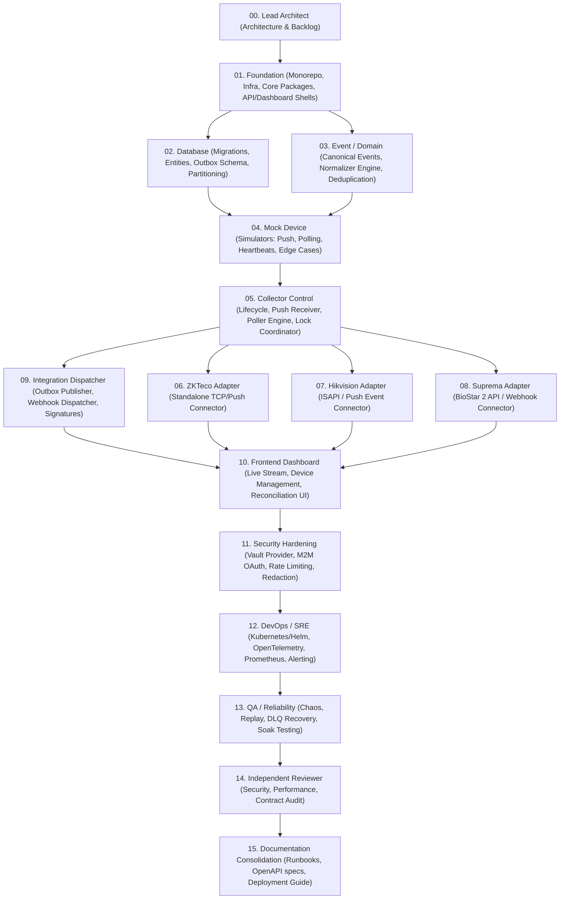

# Architecture Implementation Backlog & Sequence

This document defines the prioritized roadmap, dependency sequence, and contract ownership for the Enterprise Attendance Integration Platform, coordinated by the **Lead Architect (Agent 00)**.

---

## 1. Dependency Graph & Phase Sequencing

---

## 2. Phase Breakdown & Acceptance Criteria

### Phase 00: Lead Architect (Active)

- **Scope**: Target architecture validation, ADR maintenance, contract ownership, prioritized backlog.
- **Deliverables**: `docs/BACKLOG.md`, contract governance rules in `packages/contracts`.

### Phase 01: Foundation (Active)

- **Scope**: Monorepo scaffolding, strict TypeScript, shared packages (`contracts`, `config`, `logging`, `database`, `redis`, `kafka`, `observability`), NestJS Fastify API, Next.js dashboard shell, Docker Compose, baseline CI.
- **Deliverables**: Verified builds, typecheck, lint, and unit test suites across all packages and apps.

### Phase 02: Database & Storage Engine

- **Scope**: Database schema migrations (MySQL 8.4), Knex/Kysely/Prisma integration, monthly range partitioning for `raw_punch_logs` and `attendance_logs`, keyset pagination queries, transactional outbox table.
- **Dependencies**: Phase 01.

### Phase 03: Event Domain & Normalization Engine

- **Scope**: Normalization worker subscribing to `attendance.raw.v1`, employee ID resolution lookup, canonical punch & verification mapping, event fingerprinting / deduplication, transactional persistence + outbox generation.
- **Dependencies**: Phase 01, Phase 02.

### Phase 04: Mock Device & Emulation Suite

- **Scope**: Programmable mock device simulator supporting push punches, polling endpoints, simulated clock drift, network timeouts, duplicate burst punches.
- **Dependencies**: Phase 01, Phase 03.

### Phase 05: Collector Control Service

- **Scope**: Device connection lifecycle manager, health probes, polling job coordinator with Redis distributed locking, raw event ingestion endpoints publishing to `attendance.raw.v1`.
- **Dependencies**: Phase 04.

### Phases 06–08: Vendor Adapters (ZKTeco, Hikvision, Suprema)

- **Scope**: Plugin-based adapters implementing the standard device connector interface. SDK isolation boundaries, protocol translation, and raw event publishing.
- **Dependencies**: Phase 05.

### Phase 09: Outbound Integration Dispatcher

- **Scope**: Transactional outbox publisher to `attendance.normalized.v1`, webhook worker with HMAC-SHA256 signatures, exponential backoff with jitter, dead-letter queue routing (`attendance.dlq.v1`), and replay APIs.
- **Dependencies**: Phase 03, Phase 05.

### Phase 10: Operational Frontend Dashboard

- **Scope**: Full dashboard views for device inventory, live punch telemetry, mapping management, sync job triggers, integration audit, and alert center.
- **Dependencies**: Phase 09.

### Phases 11–15: Production Hardening, DevOps, QA, Audit & Docs

- **Scope**: Secret management integration (Vault/AWS), OpenTelemetry distributed tracing, Prometheus metrics, chaos and load testing, contract compliance audit, final operational runbooks.
- **Dependencies**: Phase 10.

---

## 3. Public Contract Ownership Rules

1. **Contracts Package (`packages/contracts`)** is the single source of truth for:
   - Kafka topic names and schema versions.
   - Domain models, status enums, and validation schemas.
   - API request/response envelopes and keyset pagination types.
2. **Backward Compatibility**: Any contract modification must be additive. Breaking schema modifications require incrementing the topic version (e.g., `attendance.raw.v2`) and filing an ADR.
3. **Vendor Isolation**: Vendor-specific payloads must only be encapsulated inside the `rawPayload` field and vendor-specific adapter modules.
