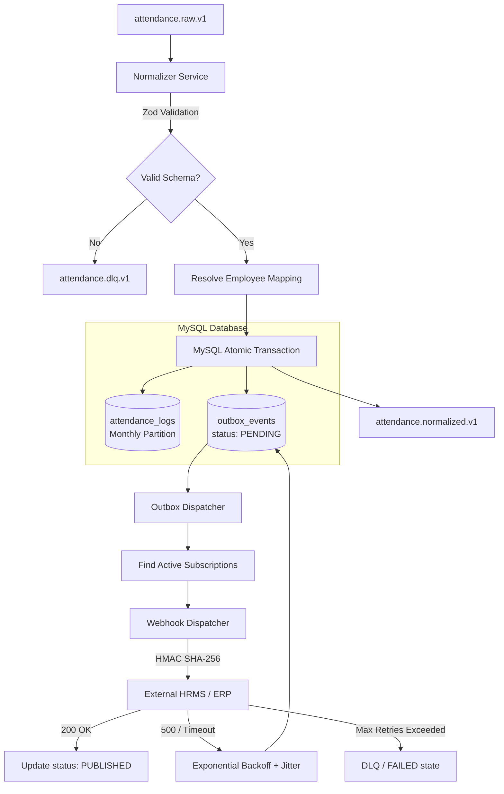

# Enterprise Outbound Integration & Normalizer Engine

## Overview

The **Outbound Integration & Normalizer Engine** (`@attendance/integration`) processes raw biometric events, enforces deterministic idempotency, resolves external employee mappings, records normalized attendance into partitioned MySQL tables with transactional outbox events, and reliably dispatches HMAC SHA-256 signed webhooks to external HRMS, ERP, and payroll endpoints.



---

## 1. Transactional Outbox Guarantee

### Critical Architecture Rule

> **External HRMS/ERP availability MUST NEVER be part of the attendance database transaction.**

1. The **Normalizer** writes the attendance record into `attendance_logs` and simultaneously writes an event envelope into `outbox_events` within the **same MySQL database transaction**.
2. If MySQL commits, both the attendance log and the outbox event are durable.
3. The **Outbox Dispatcher** polls pending outbox entries independently. If an external HRMS is down (returning HTTP 500 or timeout), the attendance record remains safely persisted in MySQL, and the outbox event is scheduled for retry with exponential backoff and jitter.
4. Once the external HRMS recovers, the outbox event is delivered with the **exact same stable event ID**, guaranteeing at-least-once delivery with end-to-end idempotency.

---

## 2. Deterministic SHA-256 Fingerprint & Idempotency

To prevent duplicate punch recordings across multiple device pulls or overlapping push requests, the platform computes a deterministic SHA-256 hash:

$$\text{Fingerprint} = \text{SHA256}(\text{organizationId} \mid \text{employeeId} \mid \text{deviceId} \mid \text{punchTimeUtc} \mid \text{punchType})$$

The database enforces a composite unique constraint `uq_attendance_fingerprint (event_fingerprint, event_date)`. Duplicate raw events arriving from hardware terminals are acknowledged idempotently without creating duplicate database rows.

---

## 3. Webhook HMAC SHA-256 Signature Verification

Every outbound webhook includes cryptographic authentication headers:

- `X-Attendance-Event-Id`: Unique event ID.
- `X-Attendance-Timestamp`: Unix timestamp in milliseconds when request was generated.
- `X-Attendance-Signature`: HMAC SHA-256 signature in format `sha256=<hex_digest>`.
- `X-Attendance-Attempt`: Attempt number (e.g. `1`, `2`, `3`).

### Receiver Verification Example (Node.js / Express)

```javascript
const crypto = require('crypto');

function verifyAttendanceWebhook(req, secret) {
  const signature = req.headers['X-Attendance-Signature'.toLowerCase()];
  const timestamp = req.headers['X-Attendance-Timestamp'.toLowerCase()];
  const payload = JSON.stringify(req.body);

  // Prevent replay attacks (reject timestamps older than 5 minutes)
  const fiveMinutesMs = 5 * 60 * 1000;
  if (Math.abs(Date.now() - parseInt(timestamp, 10)) > fiveMinutesMs) {
    return false;
  }

  const expectedSignature =
    'sha256=' + crypto.createHmac('sha256', secret).update(`${timestamp}.${payload}`).digest('hex');

  return crypto.timingSafeEqual(Buffer.from(signature), Buffer.from(expectedSignature));
}
```

---

## 4. Operational CLI Commands

| Command                                 | Description                                                                                                               |
| :-------------------------------------- | :------------------------------------------------------------------------------------------------------------------------ |
| `pnpm run normalizer:sample`            | Ingests and normalizes a sample biometric event, creates outbox entry, and publishes to Kafka `attendance.normalized.v1`. |
| `pnpm run outbox:process-once`          | Polls and dispatches a batch of pending outbox events to registered integration endpoints.                                |
| `pnpm run integration:test-webhook`     | Sends a test signed webhook to verify endpoint reachability.                                                              |
| `pnpm run integration:replay <eventId>` | Replays an outbox event by ID with full audit log trail.                                                                  |
